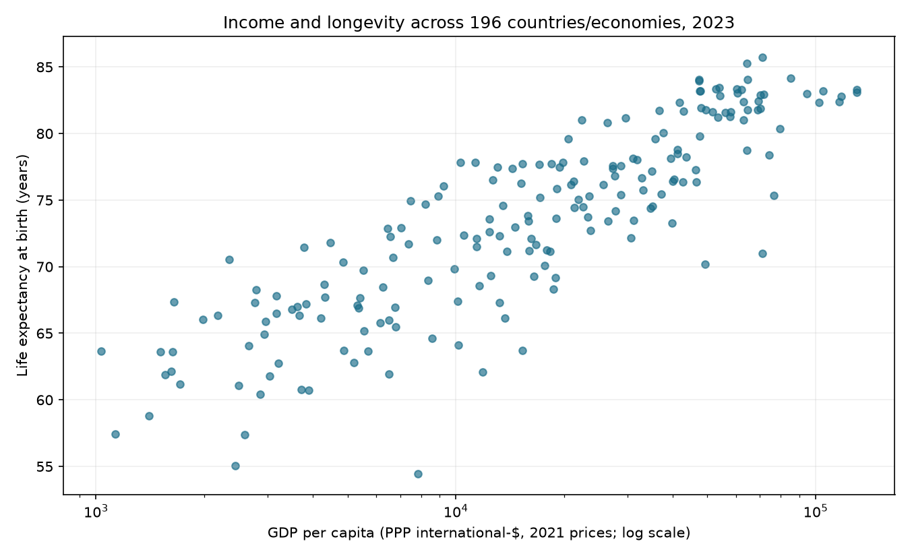
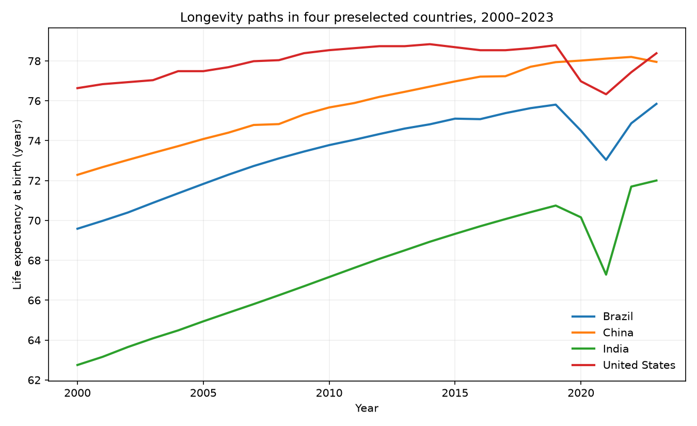

# Real-world Data Wrangling: income and longevity

A completed Udacity data-wrangling notebook combining a programmatically downloaded GDP CSV with a World Bank life-expectancy JSON API response. The supplied assignment is **Real-world Data Wrangling**, despite the local parent folder being named `real-world-trading`; this is not a trading system.

Open **[Data_Wrangling_Project_Starter.ipynb](Data_Wrangling_Project_Starter.ipynb)** first. It contains all five assignment stages and saved results from a fresh-kernel execution, including both plots. No API key is required.

## Question and findings

How is income associated with longevity across countries, and how did longevity change in four selected countries between 2000 and 2023?

- Sources: 7,445 GDP observations and 6,384 life-expectancy API records.
- Final table: 4,705 country-year observations, 198 countries/economies, five variables, 2000–2023.
- Latest shared year: 2023, with 196 observations and Pearson correlation **0.863** between log10 GDP per capita and life expectancy.
- Longevity gains from 2000 to 2023: India 9.25 years, Brazil 6.26, China 5.67, United States 1.75.

These are descriptive associations, not causal estimates. GDP is PPP-adjusted international dollars at **2021 prices**; life expectancy is in years. Coverage is unbalanced and includes separately reported economies rather than only sovereign states.

### Final data dictionary

| Column | Type | Meaning and units |
|---|---|---|
| `country_code` | string | Source entity identifier; part of the unique key |
| `country` | string | Country/economy display label from the GDP source |
| `year` | integer | Calendar year, 2000–2023; part of the unique key |
| `gdp_per_capita_ppp` | float | PPP international dollars per person at 2021 prices |
| `life_expectancy_years` | float | Life expectancy at birth, years |

The unique observation key is `(country_code, year)`; country labels are not join keys.





## Reproduce

Validated with Python 3.13.5. From this repository directory:

```bash
python3.13 -m venv .venv
source .venv/bin/activate
python -m pip install -r requirements-lock.txt
python run_notebook.py
python -m pytest -q
```

The runner uses a fresh kernel from the current interpreter and saves the executed notebook in place. Included raw snapshots make normal reruns independent of source-network access; each cached payload is checked against its recorded SHA-256. Jupyter needs permission to open local kernel sockets. To acquire updated public data instead:

```bash
WRANGLING_REFRESH=1 python run_notebook.py
```

Refresh changes the data vintage. Recheck all findings and update the snapshot-specific narrative and evidence after a refresh; never assume historical counts or correlations still hold. `build_notebook.py` is the authoring helper, **not** the normal run command: it resets outputs before execution and should only be used when deliberately revising the analysis.

## Rubric evidence

| Requirement | Evidence |
|---|---|
| Two datasets, two gathering methods | Notebook cells 10 and 12; exact CSV and API response under `data/raw/` |
| Two quality issues | 24 null measurements; 120 blank identifiers (24 overlap); visual previews and counts in Section 2 |
| Two tidiness issues | Nested country/indicator JSON objects; a shared country-year unit split across tables |
| Validated cleaning | Section 3; immutable raw hashes, separate row accounting, atomic columns, one-to-one merge validation |
| Raw and cleaned storage | `data/raw/`, `data/cleaned/`, provenance and cleaning audit JSON |
| At least four final variables | `country_year_income_longevity.csv` has code, country, year, GDP and life expectancy |
| Two interpreted plots | Section 5, embedded PNG outputs and `figures/` |
| Executed deliverable | All 26 code cells executed, no error outputs; 18 tests include saved plots, required comments and raw-to-final reconstruction |

Missing measures occur in the `Not classified` aggregate; blank codes occur in income aggregates. These are completeness limitations relative to this analytical schema, not evidence that the provider's aggregate representation is corrupt: aggregates may intentionally lack ISO-country codes. No individual-country records are removed by these two steps in this snapshot. After removing 24 null measurements, another 96 records lack identifiers. The outer join reports 4,705 matched, 328 GDP-only and 1,559 life-only keys within the selected year window; unmatched keys are not imputed. The remaining three-letter-code guard removes zero matched rows in this snapshot, and is not claimed as a fifth cleaning issue. An evaluator may prefer quality issues affecting individual-country measurements; that interpretation risk is disclosed rather than presented as resolved by test results.

## Course submission

The supplied course instructions require a **compressed ZIP containing the completed notebook and datasets**. Public GitHub publication is the requested source deliverable, not a replacement for that upload. `SUBMISSION.md` describes the locally prepared package, its validation, and the remaining course-upload step; no Udacity upload or passing grade is claimed.

## Sources and attribution

- Our World in Data, *GDP per capita*, chart data and metadata, citing Eurostat, OECD, IMF and World Bank (2026): https://ourworldindata.org/grapher/gdp-per-capita-worldbank
- World Bank World Development Indicators, *Life expectancy at birth, total (years)*, indicator `SP.DYN.LE00.IN`: https://data.worldbank.org/indicator/SP.DYN.LE00.IN
- Exact request URLs, retrieval timestamps, byte lengths and checksums: `data/raw/provenance.json`.

Dataset rights remain with their respective providers; consult the source terms for reuse. The supplied Udacity starter sections are retained. Implementation and validation were developed with AI assistance and should be reviewed and understood by the submitting student; this repository does not claim an external grade or institutional approval.

`PROJECT_REQUIREMENTS.md` records the source register and rubric mapping. `VALIDATION.md` separates tests, actual notebook execution, visual inspection and publication checks.
